<picture>
  <source media="(prefers-color-scheme: dark)" srcset="assets/hero-hud-dark.svg">
  
</picture>

Data Analyst and Engineer · NextGenTek USA · Boston, Massachusetts  
Healthcare data, SQL, Python, ETL · AI, LLMs, and RAG  
MS Analytics, Northeastern · B.Tech Computer Science, Lendi / JNTU

I turn regulated data into pipelines, reports, and AI tools people can check. Open to Data Analyst, Data Engineer, Analytics Engineer, and AI Engineer roles in the United States, on-site, hybrid, or remote.

<a href="mailto:pranathesw@gmail.com">
  <picture>
    <source media="(prefers-color-scheme: dark)" srcset="assets/email-dark.svg">
    
  </picture>
</a>
&nbsp;
<a href="https://www.linkedin.com/in/devasai-pranatheswar">
  <picture>
    <source media="(prefers-color-scheme: dark)" srcset="assets/linkedin-dark.svg">
    
  </picture>
</a>

<picture>
  <source media="(prefers-color-scheme: dark)" srcset="assets/terminal-dark.svg">
  
</picture>

<picture>
  <source media="(prefers-color-scheme: dark)" srcset="assets/divider-datastream-dark.svg">
  
</picture>

## What I build

<table>
<tr>
<td width="52%" valign="top">

**Guideline answers.** Drafts a response from a clinical guideline, and flags a person when the source does not support it.

**Discharge risk.** Scores whether a hospital stay will run long, using only what is known at admission, then waits for a person before a referral counts as sent.

**Bills and evidence.** Compares a bill with the hospital's published rate, walks a genetic variant through evidence rules, and checks a neural-data policy for a real citation.

</td>
<td width="48%" valign="top">

<picture>
  <source media="(prefers-color-scheme: dark)" srcset="assets/neural-net-dark.svg">
  
</picture>

</td>
</tr>
</table>

<picture>
  <source media="(prefers-color-scheme: dark)" srcset="assets/divider-datastream-dark.svg">
  
</picture>

## Featured work

<table>
<tr>
<td width="50%" valign="top">

<a href="https://github.com/devasai-choppa/Sentinal_RAG">
  <picture>
    <source media="(prefers-color-scheme: dark)" srcset="assets/project-cards/sentinel-rag-dark.svg">
    
  </picture>
</a>

Answers a question from a clinical guideline, then checks whether the draft is actually supported. If the guideline does not cover the question, or the draft contradicts it, the system flags a person instead of guessing. The sample guideline in the repo is fictional. This is not a medical device.

<a href="https://github.com/devasai-choppa/Sentinal_RAG/blob/main/sentinel-rag/docs/demo.gif"><picture><source media="(prefers-color-scheme: dark)" srcset="assets/btn-demo-dark.svg"></picture></a>&nbsp;<a href="https://github.com/devasai-choppa/Sentinal_RAG/blob/main/sentinel-rag/docs/ARCHITECTURE.md"><picture><source media="(prefers-color-scheme: dark)" srcset="assets/btn-arch-dark.svg"></picture></a>&nbsp;<a href="https://github.com/devasai-choppa/Sentinal_RAG/blob/main/sentinel-rag/README.md"><picture><source media="(prefers-color-scheme: dark)" srcset="assets/btn-readme-dark.svg"></picture></a>

</td>
<td width="50%" valign="top">

<a href="https://github.com/devasai-choppa/Clear-Bed">
  <picture>
    <source media="(prefers-color-scheme: dark)" srcset="assets/project-cards/clearbed-dark.svg">
    
  </picture>
</a>

Estimates whether a hospital stay will run long, what is blocking discharge, and how many days might have been avoided. It trains only on what is known at admission, and the build stops if a later outcome leaked into those features. A nursing-home suggestion waits until a person approves it. The patients are synthetic. The nursing-home list is the real CMS Care Compare file.

<a href="https://github.com/devasai-choppa/Clear-Bed/blob/main/docs/walkthrough.gif"><picture><source media="(prefers-color-scheme: dark)" srcset="assets/btn-demo-dark.svg"></picture></a>&nbsp;<a href="https://github.com/devasai-choppa/Clear-Bed#architecture"><picture><source media="(prefers-color-scheme: dark)" srcset="assets/btn-arch-dark.svg"></picture></a>&nbsp;<a href="https://github.com/devasai-choppa/Clear-Bed"><picture><source media="(prefers-color-scheme: dark)" srcset="assets/btn-readme-dark.svg"></picture></a>

</td>
</tr>
<tr>
<td width="50%" valign="top">

<a href="https://github.com/devasai-choppa/acmg-triage">
  <picture>
    <source media="(prefers-color-scheme: dark)" srcset="assets/project-cards/acmg-triage-dark.svg">
    
  </picture>
</a>

Walks a genetic variant through the ACMG/AMP evidence rules, one rule at a time. Literature comes from a saved cache, not a live model. If the rules conflict, or the variant is outside the catalog, it refuses to make a call. On 100 designed test cases it matches a rules-only baseline 67 percent of the time.

<a href="https://github.com/devasai-choppa/acmg-triage/blob/main/demo/out/acmg-triage-demo.gif"><picture><source media="(prefers-color-scheme: dark)" srcset="assets/btn-demo-dark.svg"></picture></a>&nbsp;<a href="https://github.com/devasai-choppa/acmg-triage/blob/main/src/acmg_triage/graph.py"><picture><source media="(prefers-color-scheme: dark)" srcset="assets/btn-arch-dark.svg"></picture></a>&nbsp;<a href="https://github.com/devasai-choppa/acmg-triage"><picture><source media="(prefers-color-scheme: dark)" srcset="assets/btn-readme-dark.svg"></picture></a>

</td>
<td width="50%" valign="top">

<a href="https://github.com/devasai-choppa/neuroprivacy">
  <picture>
    <source media="(prefers-color-scheme: dark)" srcset="assets/project-cards/neuroprivacy-dark.svg">
    
  </picture>
</a>

Reads a company's neural-data policy and checks it against Colorado and California neural-privacy laws. A claim counts only when it points at the exact words in the policy. On 20 hand-labeled examples the field score is perfect, and a public hold-out is still open. This is not legal advice.

<a href="https://github.com/devasai-choppa/neuroprivacy/blob/main/demo/out/neuroprivacy-demo.gif"><picture><source media="(prefers-color-scheme: dark)" srcset="assets/btn-demo-dark.svg"></picture></a>&nbsp;<a href="https://github.com/devasai-choppa/neuroprivacy/blob/main/src/neuroprivacy/scoring.py"><picture><source media="(prefers-color-scheme: dark)" srcset="assets/btn-arch-dark.svg"></picture></a>&nbsp;<a href="https://github.com/devasai-choppa/neuroprivacy"><picture><source media="(prefers-color-scheme: dark)" srcset="assets/btn-readme-dark.svg"></picture></a>

</td>
</tr>
<tr>
<td width="50%" valign="top">

<a href="https://github.com/devasai-choppa/eeg-harmonize">
  <picture>
    <source media="(prefers-color-scheme: dark)" srcset="assets/project-cards/eeg-harmonize-dark.svg">
    
  </picture>
</a>

Turns EEG recordings into one common format. It rejects a bad unit scale, keeps the standard channels, resamples the signal, and records each step so the conversion can be traced. The clips in the repo were made for this demo. A test on the TUH corpus was not run, and that corpus is not included.

<a href="https://github.com/devasai-choppa/eeg-harmonize/blob/main/demo/out/eeg-harmonize-demo.gif"><picture><source media="(prefers-color-scheme: dark)" srcset="assets/btn-demo-dark.svg"></picture></a>&nbsp;<a href="https://github.com/devasai-choppa/eeg-harmonize/blob/main/src/eeg_harmonize/convert.py"><picture><source media="(prefers-color-scheme: dark)" srcset="assets/btn-arch-dark.svg"></picture></a>&nbsp;<a href="https://github.com/devasai-choppa/eeg-harmonize"><picture><source media="(prefers-color-scheme: dark)" srcset="assets/btn-readme-dark.svg"></picture></a>

</td>
<td width="50%" valign="top">

<a href="https://github.com/devasai-choppa/CareTrace">
  <picture>
    <source media="(prefers-color-scheme: dark)" srcset="assets/project-cards/caretrace-dark.svg">
    
  </picture>
</a>

Tells you what a hospital published for a procedure, whether a provider looks in network, whether prior authorization is required and on which page, and whether a bill matches that rate. A dollar the tools never returned is removed from the answer. Estimates are not quotes, and appeal letters are drafts. The scored demo uses five sample hospital files and synthetic bills. Not legal or medical advice.

<a href="https://github.com/devasai-choppa/CareTrace/blob/main/docs/DEMO_SCRIPT.md"><picture><source media="(prefers-color-scheme: dark)" srcset="assets/btn-demo-dark.svg"></picture></a>&nbsp;<a href="https://github.com/devasai-choppa/CareTrace/blob/main/docs/ARCHITECTURE.md"><picture><source media="(prefers-color-scheme: dark)" srcset="assets/btn-arch-dark.svg"></picture></a>&nbsp;<a href="https://github.com/devasai-choppa/CareTrace"><picture><source media="(prefers-color-scheme: dark)" srcset="assets/btn-readme-dark.svg"></picture></a>

</td>
</tr>
</table>

## Genomics and neuro

<table>
<tr>
<td width="40%" valign="top">

<picture>
  <source media="(prefers-color-scheme: dark)" srcset="assets/dna-helix-dark.svg">
  
</picture>

</td>
<td width="60%" valign="top">

<picture>
  <source media="(prefers-color-scheme: dark)" srcset="assets/brain-eeg-dark.svg">
  
</picture>

</td>
</tr>
</table>

## Where it goes deep

The six cards are the short version. This is the same work, with the limits written out.

**[Sentinel-RAG](https://github.com/devasai-choppa/Sentinal_RAG)** answers a question from a clinical guideline. Search uses a 100-word child passage. The draft is written from the surrounding 500-word section, with Llama 3.1 8B through Groq. Embeddings are `all-MiniLM-L6-v2`. The steps are retrieve, generate, reflect, and output. Reflect scores the draft and can ask a second model, at temperature 0, whether the draft is supported, partly supported, or contradicted. No context, a question the guideline does not cover, or a contradicted draft becomes FLAG. A supported draft, or one already grounded and at 0.75, is returned. Otherwise 0.85 returns immediately, and 0.75 can search again up to twice. Bedside mode can skip the second model call when the first score is already high. FLAG is recorded by the output step from a decision inside reflect. It is not an extra step. A live draft needs `GROQ_API_KEY`. The guideline in the repo is fictional. Not a medical device.

**[ClearBed](https://github.com/devasai-choppa/Clear-Bed)** estimates a delayed discharge from synthetic hospital stays. Synthea lands in DuckDB. dbt builds the admission snapshot and the stay labels. LightGBM predicts whether the stay gets stuck, what the barrier is, and how many days might have been avoided. Categories are one-hot encoded, and SHAP is read for the positive class. The build fails if a label leaked onto the admission snapshot, if too many features are empty, or if there are too few stays. A nursing-home match uses the real CMS Care Compare file and waits until a person approves it. Approval records that it was sent. It does not transmit the referral.

**[acmg-triage](https://github.com/devasai-choppa/acmg-triage)** turns an ACMG/AMP variant review into a typed trail. Each evidence code is its own step, then a VCEP overlay, then literature that is read only from a saved cache. The runner is hand-rolled, and there is no live language model on this path. Conflicting calls, and variants outside the catalog, are refused. On 100 designed probes it agrees with a rules-only baseline 0.670 of the time.

**[neuroprivacy](https://github.com/devasai-choppa/neuroprivacy)** checks a consumer neural-data policy against Colorado HB24-1058 and California SB 1223. Extraction is deterministic. A field marked true without a character offset is a citation gap. Mean field F1 is 1.000 on 20 hand-labeled samples. The live public hold-out is still open. The output is not a legal opinion.

**[eeg-harmonize](https://github.com/devasai-choppa/eeg-harmonize)** reads an EDF file, rejects a bad unit scale, drops channels that are not in the standard set, resamples with `scipy.signal.resample_poly`, and appends every step to a provenance chain. The clips in the repo were designed for the demo. A TUH transfer was not run, and TUH is not in the repository.

**[CareTrace](https://github.com/devasai-choppa/CareTrace)** closes the gap between a hospital's published price and the bill that arrives later. Machine-readable price files become Parquet. dbt and DuckDB build the mart the agent reads. The LangGraph steps are router, clarify, execute, synthesize, and verifier. The verifier deletes a sentence whose number is not in the tool result. A published dollar keeps its source file, row hash, and ingest time. A guessed interval is a separate object and is never shown as the hospital's price. Prior authorization cites the policy page, or comes back unknown when the code is not in the policy. An uploaded explanation of benefits can be audited, and the appeal is a draft. The default model is a mock. On the sample files, price exact-match is 1.000 for 50 questions. Interval coverage of 0.957 was measured on a simulated price process, not on held-out hospital files. Five sample hospitals, three payers, one imaging policy, and synthetic bills. Not legal or medical advice.

**[EEG motor imagery](https://github.com/devasai-choppa/EEG-Motor-Imagery-Classifier)** trains on PhysioNet EEGMMIDB with MNE and PyTorch, in a band of about 8–30 Hz. CSP plus SVM is 47.7 percent for the same person. EEGNet is 32.2 percent leave-one-subject-out. Those figures are the ones published in that README.

**Tools in the featured repos.** Python, SQL, DuckDB, pandas, dbt, LightGBM, LangGraph, Chroma, FastAPI, React, Next.js, Docker. The outer ring is methods that code runs: retrieval-augmented generation, embeddings, SHAP, and conformal prediction. Other imported libraries live in the public code and are not drawn on the orbit.

<picture>
  <source media="(prefers-color-scheme: dark)" srcset="assets/stack-orbit-dark.svg">
  
</picture>

<picture>
  <source media="(prefers-color-scheme: dark)" srcset="assets/divider-datastream-dark.svg">
  
</picture>

## Experience

**Data Analyst** · NextGenTek USA Inc · Full-time · Jun 2026–present · Boston · Remote

The firm is headquartered in Dallas. I gather and check data from internal systems, write SQL across those systems, resolve discrepancies, and build the reports teams use to track performance. I work with engineering on how data moves through applications, APIs, and databases.

**Public Health Intelligence Analyst** · Boston Public Health Commission · Internship · Jan 2025–Apr 2025 · Boston · Remote

MS Analytics capstone with Northeastern. I analyzed 100,000+ HIPAA-regulated public-health records with Python and SQL, built prototypes for structured and unstructured language data, and presented the findings in Tableau. The reporting served the City of Boston, about 675,000 residents.

**Generative AI Engineer Intern** · MassChallenge · Internship · Nov 2023–May 2024 · Boston · Remote

MS experiential project with Northeastern. I wrote the annotation instructions and quality checks, then built a RAG pipeline for speech and text with LangChain, spaCy, and NLTK.

**Machine Learning and Data Engineering Intern** · Pola IT Solutions · Internship · Mar 2021–May 2023 · Remote from India

Models on e-commerce transactions with Python and scikit-learn. ETL for inventory, customers, and orders with SQL and pandas. The backend ran on AWS.

**Volunteer Data Analyst** · Bright Mind · Aug 2025–Jun 2026

Unpaid work for Bright Mind Enrichment and Schooling, a 501(c)(3). I cleaned data and tracked campaign metrics with SQL and R.

Tools I use in this work, outside the repo orbit above: Tableau, Power BI, Snowflake, AWS, and Excel.

## Education

**Northeastern University** · MS Analytics · Sep 2023–Apr 2025 · 3.67/4  
Applied Machine Intelligence.

**Jawaharlal Nehru Technological University** · B.Tech Computer Science · Aug 2019–May 2023 · 3.5/4  
Lendi Institute of Engineering and Technology.

## Research

**Crop Yield Forecasting and Fertilizer Recommendation Using Voting Classifier.** IJRTI, June 2023. Third author, with B. Chakradhar, D. Sai Veena, and A. Vivek, while at Lendi Institute of Engineering and Technology. [PDF](https://www.ijrti.org/papers/IJRTI2306158.pdf)

### Latest posts

<!--BLOG-POST-LIST-->
<!-- BLOG-POST-LIST:START -->
No public RSS feed is connected yet.
<!-- BLOG-POST-LIST:END -->

## Contributions

<picture>
  <source media="(prefers-color-scheme: dark)" srcset="profile-3d-contrib/profile-hud-dark.svg">
  
</picture>

<picture>
  <source media="(prefers-color-scheme: dark)" srcset="https://github-readme-stats.vercel.app/api?username=devasai-choppa&show_icons=true&hide_border=true&title_color=00F5D4&text_color=C9D1D9&icon_color=F72585&bg_color=0D1117">
  
</picture>
&nbsp;
<picture>
  <source media="(prefers-color-scheme: dark)" srcset="https://github-readme-stats.vercel.app/api/top-langs/?username=devasai-choppa&layout=compact&hide_border=true&langs_count=6&title_color=00F5D4&text_color=C9D1D9&icon_color=F72585&bg_color=0D1117">
  
</picture>

<picture>
  <source media="(prefers-color-scheme: dark)" srcset="https://streak-stats.demolab.com?user=devasai-choppa&hide_border=true&background=0D1117&stroke=0D1117&ring=00F5D4&fire=F72585&currStreakNum=E6EDF3&sideNums=E6EDF3&currStreakLabel=8B9BAB&sideLabels=8B9BAB&dates=5C6E7E">
  
</picture>

<picture>
  <source media="(prefers-color-scheme: dark)" srcset="dist/github-contribution-grid-snake-dark.svg">
  
</picture>

## Activity

<!--RECENT_ACTIVITY-->
<!--START_SECTION:activity-->
1. 💪 Opened PR [#2](https://github.com/devasai-choppa/CareTrace/pull/2) in [devasai-choppa/CareTrace](https://github.com/devasai-choppa/CareTrace)
<!--END_SECTION:activity-->

## Open to work

Data Analyst, Data Engineer, Analytics Engineer, and AI Engineer roles. United States. On-site, hybrid, or remote. Healthcare is the focus.

<a href="mailto:pranathesw@gmail.com">
  <picture>
    <source media="(prefers-color-scheme: dark)" srcset="assets/email-dark.svg">
    
  </picture>
</a>
&nbsp;
<a href="https://www.linkedin.com/in/devasai-pranatheswar">
  <picture>
    <source media="(prefers-color-scheme: dark)" srcset="assets/linkedin-dark.svg">
    
  </picture>
</a>
