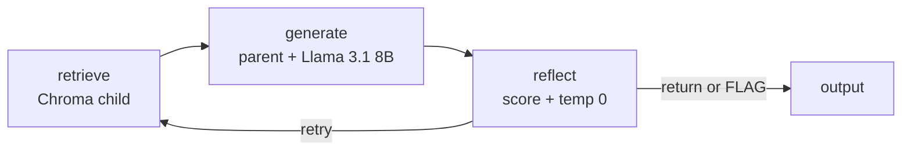

<picture>
  <source media="(prefers-color-scheme: dark)" srcset="assets/header-dark.svg">
  
</picture>

<picture>
  <source media="(prefers-color-scheme: dark)" srcset="assets/typing-dark.svg">
  
</picture>

Data Analyst at NextGenTek USA · Boston  
MS Analytics (Applied Machine Intelligence), Northeastern · B.Tech CS, Lendi / JNTU

<a href="mailto:pranathesw@gmail.com">
  <picture>
    <source media="(prefers-color-scheme: dark)" srcset="assets/email-dark.svg">
    
  </picture>
</a>
&nbsp;
<a href="https://www.linkedin.com/in/devasai-pranatheswar">
  <picture>
    <source media="(prefers-color-scheme: dark)" srcset="assets/linkedin-dark.svg">
    
  </picture>
</a>

<picture>
  <source media="(prefers-color-scheme: dark)" srcset="assets/divider-dark.svg">
  
</picture>

## 01 · Systems

| Plane | Control surface |
| --- | --- |
| Agents | LangGraph `retrieve → generate → reflect → output`. A Python score plus a temperature-0 verdict. FLAG is a state. |
| Warehouse | DuckDB `raw` → dbt marts → LightGBM. The build fails if a label leaked. A referral waits on a person. |
| Evidence | One ACMG node per code. EEG `resample_poly` with an append-only chain. A policy field needs a character span. |

<picture>
  <source media="(prefers-color-scheme: dark)" srcset="assets/divider-dark.svg">
  
</picture>

## 02 · Featured work

<table>
<tr>
<td width="50%" valign="top">

<a href="https://github.com/devasai-choppa/Sentinal_RAG">
  <picture>
    <source media="(prefers-color-scheme: dark)" srcset="assets/cards/sentinel-rag-dark.svg">
    
  </picture>
</a>

`retrieve → generate → reflect → output`

Child hit in Chroma, parent context to Llama 3.1 8B. Empty context, an off-corpus query, or `CONTRADICTED` is FLAG. The in-repo corpus is a fictional diabetes guideline. Not a device.

[▶ Demo](https://github.com/devasai-choppa/Sentinal_RAG/blob/main/sentinel-rag/docs/demo.gif) · [📐 Architecture](https://github.com/devasai-choppa/Sentinal_RAG/blob/main/sentinel-rag/docs/ARCHITECTURE.md) · [📄 README](https://github.com/devasai-choppa/Sentinal_RAG/blob/main/sentinel-rag/README.md)

</td>
<td width="50%" valign="top">

<a href="https://github.com/devasai-choppa/Clear-Bed">
  <picture>
    <source media="(prefers-color-scheme: dark)" srcset="assets/cards/clearbed-dark.svg">
    
  </picture>
</a>

`raw → dbt marts → LightGBM → interrupt`

Stuck-risk, barrier type, and avoidable days. The quality report fails on a leaked label, high nulls, or too few stays. `sent` is recorded only after approval. Nothing is transmitted. Stays are synthetic. The CMS Care Compare file is the national nursing-home catalog.

[▶ Demo](https://github.com/devasai-choppa/Clear-Bed/blob/main/docs/walkthrough.gif) · [📐 Architecture](https://github.com/devasai-choppa/Clear-Bed#architecture) · [📄 README](https://github.com/devasai-choppa/Clear-Bed)

</td>
</tr>
<tr>
<td width="50%" valign="top">

<a href="https://github.com/devasai-choppa/acmg-triage">
  <picture>
    <source media="(prefers-color-scheme: dark)" srcset="assets/cards/acmg-triage-dark.svg">
    
  </picture>
</a>

`rules → VCEP → cache → refuse`

Pydantic `GraphState`, one node per ACMG/AMP code, literature from a committed cache only. No live LLM. Conflict or an uncovered variant is refused. Concordance with the rules-only baseline is 0.670 on 100 designed probes.

[▶ Demo](https://github.com/devasai-choppa/acmg-triage/blob/main/demo/out/acmg-triage-demo.gif) · [📐 Architecture](https://github.com/devasai-choppa/acmg-triage/blob/main/src/acmg_triage/graph.py) · [📄 README](https://github.com/devasai-choppa/acmg-triage)

</td>
<td width="50%" valign="top">

<a href="https://github.com/devasai-choppa/neuroprivacy">
  <picture>
    <source media="(prefers-color-scheme: dark)" srcset="assets/cards/neuroprivacy-dark.svg">
    
  </picture>
</a>

`span → offset → rule → statute`

Deterministic extract. A true field with no character offset is a citation gap. Rules cover Colorado HB24-1058 and California SB 1223. Field F1 is 1.000 on 20 hand labels. The live hold-out is open. Not a legal opinion.

[▶ Demo](https://github.com/devasai-choppa/neuroprivacy/blob/main/demo/out/neuroprivacy-demo.gif) · [📐 Architecture](https://github.com/devasai-choppa/neuroprivacy/blob/main/src/neuroprivacy/scoring.py) · [📄 README](https://github.com/devasai-choppa/neuroprivacy)

</td>
</tr>
<tr>
<td width="50%" valign="top">

<a href="https://github.com/devasai-choppa/eeg-harmonize">
  <picture>
    <source media="(prefers-color-scheme: dark)" srcset="assets/cards/eeg-harmonize-dark.svg">
    
  </picture>
</a>

`read → units → montage → resample_poly`

A bad unit scale is rejected. Each step is appended to a DuckDB provenance chain. The clips are designed. TUH transfer was not run, and TUH is not in the repository.

[▶ Demo](https://github.com/devasai-choppa/eeg-harmonize/blob/main/demo/out/eeg-harmonize-demo.gif) · [📐 Architecture](https://github.com/devasai-choppa/eeg-harmonize/blob/main/src/eeg_harmonize/convert.py) · [📄 README](https://github.com/devasai-choppa/eeg-harmonize)

</td>
<td width="50%" valign="top">

<a href="https://github.com/devasai-choppa/Hamsa">
  <picture>
    <source media="(prefers-color-scheme: dark)" srcset="assets/cards/hamsa-dark.svg">
    
  </picture>
</a>

`P-256 → HKDF → AES-GCM → verify_line`

Non-exportable device key. Per-message content key, with conversation, message, and sender bound as additional data. Unknown SKU, bad quantity, or missing stock is rejected. Price is copied from `price_paise`. UPI is an intent. The app does not hold the money.

[▶ Demo](https://github.com/devasai-choppa/Hamsa/blob/main/demo/hamsa-demo.gif) · [📐 Architecture](https://github.com/devasai-choppa/Hamsa/blob/main/docs/architecture.md) · [📄 README](https://github.com/devasai-choppa/Hamsa)

</td>
</tr>
</table>

<picture>
  <source media="(prefers-color-scheme: dark)" srcset="assets/divider-dark.svg">
  
</picture>

## 03 · Flagship: Sentinel-RAG

Compiled graph · retrieve, generate, reflect, output

Research prototype. Not a medical device. Do not use it for a clinical decision.

Four nodes in `sentinel-rag/src/agent.py`. FLAG is written by `output` from a decision inside `reflect`. It is not a fifth node. Live generation needs `GROQ_API_KEY`. The route order is in section 05.

[▶ Watch the demo](https://github.com/devasai-choppa/Sentinal_RAG/blob/main/sentinel-rag/docs/demo.gif) · [Full architecture](https://github.com/devasai-choppa/Sentinal_RAG/blob/main/sentinel-rag/docs/ARCHITECTURE.md)

<picture>
  <source media="(prefers-color-scheme: dark)" srcset="assets/divider-dark.svg">
  
</picture>

## 04 · Skills

Every name below is imported in a public repo. Cloud dashboards and TensorFlow are not listed: they are not a training path in the code.

**Languages**

<picture>
  <source media="(prefers-color-scheme: dark)" srcset="https://skillicons.dev/icons?i=py,ts&theme=dark">
  
</picture>

Python · TypeScript · SQL

**Data**

<picture>
  <source media="(prefers-color-scheme: dark)" srcset="assets/stack-data-dark.svg">
  
</picture>

<picture>
  <source media="(prefers-color-scheme: dark)" srcset="assets/stack-store-dark.svg">
  
</picture>

**Models**

<picture>
  <source media="(prefers-color-scheme: dark)" srcset="https://skillicons.dev/icons?i=sklearn,pytorch&theme=dark">
  
</picture>

<picture>
  <source media="(prefers-color-scheme: dark)" srcset="assets/stack-ml-dark.svg">
  
</picture>

<picture>
  <source media="(prefers-color-scheme: dark)" srcset="assets/stack-track-dark.svg">
  
</picture>

**Signals**

<picture>
  <source media="(prefers-color-scheme: dark)" srcset="assets/stack-signals-dark.svg">
  
</picture>

**Agents**

<picture>
  <source media="(prefers-color-scheme: dark)" srcset="assets/stack-genai-dark.svg">
  
</picture>

<picture>
  <source media="(prefers-color-scheme: dark)" srcset="assets/stack-providers-dark.svg">
  
</picture>

ClearBed selects the chat provider in code. Groq runs only when the data mode is synthetic. Ollama is local. Bedrock is the path when the data is not synthetic.

**Interfaces**

<picture>
  <source media="(prefers-color-scheme: dark)" srcset="https://skillicons.dev/icons?i=fastapi,react,nextjs,docker,nodejs,vite,tailwind&theme=dark">
  
</picture>

<picture>
  <source media="(prefers-color-scheme: dark)" srcset="assets/stack-bi-dark.svg">
  
</picture>

**Text, files, and runtime**

<picture>
  <source media="(prefers-color-scheme: dark)" srcset="assets/stack-nlp-dark.svg">
  
</picture>

<picture>
  <source media="(prefers-color-scheme: dark)" srcset="assets/stack-runtime-dark.svg">
  
</picture>

<picture>
  <source media="(prefers-color-scheme: dark)" srcset="assets/stack-io-dark.svg">
  
</picture>

**Product UI**

<picture>
  <source media="(prefers-color-scheme: dark)" srcset="assets/stack-ui-dark.svg">
  
</picture>

<picture>
  <source media="(prefers-color-scheme: dark)" srcset="assets/stack-motion-dark.svg">
  
</picture>

**Engineering**

<picture>
  <source media="(prefers-color-scheme: dark)" srcset="assets/stack-quality-dark.svg">
  
</picture>

SymPy is the closed-form PK path in AEON-7080. WebCrypto is the Hamsa browser stack: P-256, HKDF, AES-GCM. WFDB is how the motor-imagery repo reads PhysioNet.

<picture>
  <source media="(prefers-color-scheme: dark)" srcset="assets/divider-dark.svg">
  
</picture>

## 05 · Where it goes deep

**Retrieval loop.** [Sentinel-RAG](https://github.com/devasai-choppa/Sentinal_RAG) splits each guideline into a 500-word parent and 100-word children. Chroma stores both. Embeddings are `all-MiniLM-L6-v2`. Search hits the child. Generation reads the parent. The compiled LangGraph is `retrieve → generate → reflect → output`, with Llama 3.1 8B through Groq on the generate step.

`reflect` blends a Python score (context coverage, uncertainty, specificity, contradiction) with a second model call at temperature 0. That call returns `SUPPORTED`, `PARTIALLY_SUPPORTED`, or `CONTRADICTED`. Empty context, a query that misses the corpus, or `CONTRADICTED` is FLAG. A `SUPPORTED` verdict, or a corpus-grounded draft already at or above 0.75, is returned. Otherwise a score at or above 0.85 is returned, and a score at or above 0.75 retries retrieval up to 2 times. Bedside mode can skip the second call when the heuristic is already high. An old source year lowers the score. The bundled corpus is a fictional diabetes guideline. Not a medical device.

**Warehouse and discharge model.** [ClearBed](https://github.com/devasai-choppa/Clear-Bed) loads Synthea into DuckDB `raw`. dbt builds `marts.feat_admission_snapshot` and `marts.fct_stay_labels`. LightGBM fits stuck-risk, barrier type, and avoidable days from that join. Categoricals are one-hot encoded. SHAP is read for the positive class. A quality report fails the build if a label column leaked onto the admission snapshot, if feature nulls are too high, or if the stay count is too small. The placement graph matches the national CMS Care Compare nursing-home file and interrupts until a person approves. Approve records `sent`. It does not transmit. Patients are synthetic. The model-card numbers are on that synthetic label.

**Evidence graph.** [acmg-triage](https://github.com/devasai-choppa/acmg-triage) keeps `GraphState` as a Pydantic model. Each ACMG/AMP rules code is its own node, then a VCEP overlay, then literature nodes that read only a committed cache. There is no live LLM on this graph. Conflicting calls and variants outside the catalog are refused. Concordance with the rules-only baseline is 0.670 on 100 designed probes.

**Policy spans.** [neuroprivacy](https://github.com/devasai-choppa/neuroprivacy) extracts with deterministic rules. A field marked true without a character offset is a citation gap. The scorer covers Colorado HB24-1058 and California SB 1223. Mean field F1 is 1.000 on 20 hand-labeled samples. The live public-policy hold-out is still open. The output is not a legal opinion.

**EEG conversion.** [eeg-harmonize](https://github.com/devasai-choppa/eeg-harmonize) reads EDF, rejects a bad unit scale, drops non-canonical channels, resamples with `scipy.signal.resample_poly`, and appends each step to a provenance chain. The clips in the repo are designed. The TUH transfer was not run, and TUH is not in the repository.

**Encrypted cart.** [Hamsa](https://github.com/devasai-choppa/Hamsa) gives each browser device a non-exportable P-256 ECDH key. The shared secret goes through HKDF into an AES-256-GCM key. Each message has its own content key, with the conversation, message, and sender ids bound as additional data. Cart changes pass `verify_line`, which rejects an unknown SKU, a bad quantity, or stock the catalog does not have. The price is copied from `price_paise` on that catalog row. UPI is an intent to the merchant. The app does not hold the money.

**Classical ML, already measured.** [EEG motor imagery](https://github.com/devasai-choppa/EEG-Motor-Imagery-Classifier) trains on PhysioNet EEGMMIDB with MNE and PyTorch. The band is about 8–30 Hz. CSP + SVM is 47.7% on the same person. EEGNet is 32.2% leave-one-subject-out. Those are the numbers published in that README. The 2023 voting-classifier paper is linked under Research.

<picture>
  <source media="(prefers-color-scheme: dark)" srcset="assets/divider-dark.svg">
  
</picture>

## 06 · Research and writing

**Crop Yield Forecasting and Fertilizer Recommendation Using Voting Classifier.** IJRTI, June 2023. Co-authored with B. Chakradhar, D. Sai Veena, and A. Vivek while at Lendi Institute of Engineering and Technology. [PDF](https://www.ijrti.org/papers/IJRTI2306158.pdf)

### Latest posts

<!--BLOG-POST-LIST-->
<!-- BLOG-POST-LIST:START -->
No public RSS feed is connected yet.
<!-- BLOG-POST-LIST:END -->

<picture>
  <source media="(prefers-color-scheme: dark)" srcset="assets/divider-dark.svg">
  
</picture>

## 07 · Activity

<!--RECENT_ACTIVITY-->
<!--START_SECTION:activity-->
1. 💪 Opened PR [#1](https://github.com/devasai-choppa/AEON-7080/pull/1) in [devasai-choppa/AEON-7080](https://github.com/devasai-choppa/AEON-7080)
<!--END_SECTION:activity-->

<picture>
  <source media="(prefers-color-scheme: dark)" srcset="https://github-readme-stats.vercel.app/api?username=devasai-choppa&show_icons=true&hide_border=true&title_color=E7EEF4&text_color=C5D0DA&icon_color=3CBBB4&bg_color=07131C">
  
</picture>
&nbsp;
<picture>
  <source media="(prefers-color-scheme: dark)" srcset="https://github-readme-stats.vercel.app/api/top-langs/?username=devasai-choppa&layout=compact&hide_border=true&langs_count=6&title_color=E7EEF4&text_color=C5D0DA&icon_color=3CBBB4&bg_color=07131C">
  
</picture>

<picture>
  <source media="(prefers-color-scheme: dark)" srcset="https://streak-stats.demolab.com?user=devasai-choppa&hide_border=true&background=07131C&stroke=07131C&ring=3CBBB4&fire=E3B15A&currStreakNum=E7EEF4&sideNums=E7EEF4&currStreakLabel=93A4B5&sideLabels=93A4B5&dates=6E8294">
  
</picture>

<picture>
  <source media="(prefers-color-scheme: dark)" srcset="dist/github-contribution-grid-snake-dark.svg">
  
</picture>

<picture>
  <source media="(prefers-color-scheme: dark)" srcset="assets/divider-dark.svg">
  
</picture>

## 08 · Open to Data and AI roles in Boston and remote

<a href="mailto:pranathesw@gmail.com">
  <picture>
    <source media="(prefers-color-scheme: dark)" srcset="assets/email-dark.svg">
    
  </picture>
</a>
&nbsp;
<a href="https://www.linkedin.com/in/devasai-pranatheswar">
  <picture>
    <source media="(prefers-color-scheme: dark)" srcset="assets/linkedin-dark.svg">
    
  </picture>
</a>
