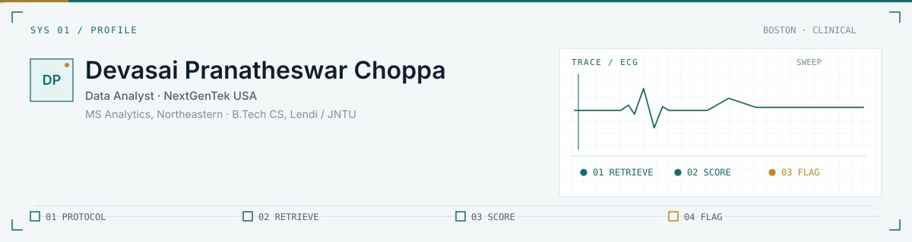
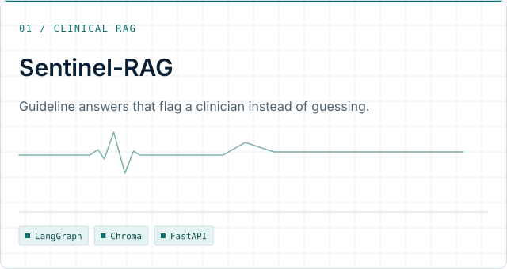
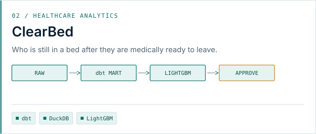
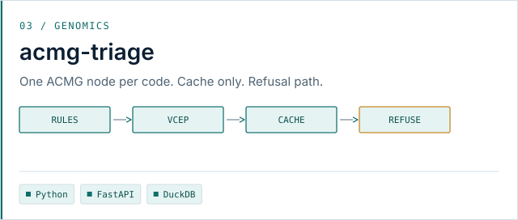
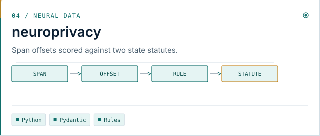
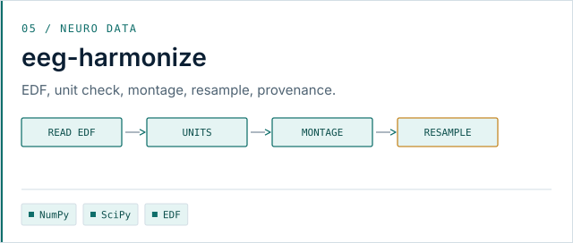
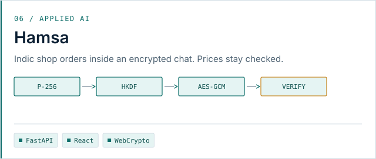
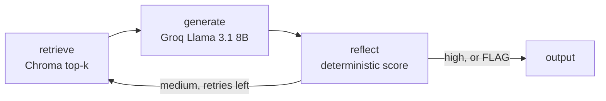

<picture>
  <source media="(prefers-color-scheme: dark)" srcset="assets/header-dark.svg">
  
</picture>

<picture>
  <source media="(prefers-color-scheme: dark)" srcset="assets/typing-dark.svg">
  
</picture>

Data Analyst at NextGenTek USA · Boston  
MS Analytics (Applied Machine Intelligence), Northeastern · B.Tech CS, Lendi / JNTU

<a href="mailto:pranathesw@gmail.com">
  <picture>
    <source media="(prefers-color-scheme: dark)" srcset="assets/email-dark.svg">
    
  </picture>
</a>
&nbsp;
<a href="https://www.linkedin.com/in/devasai-pranatheswar">
  <picture>
    <source media="(prefers-color-scheme: dark)" srcset="assets/linkedin-dark.svg">
    
  </picture>
</a>

<picture>
  <source media="(prefers-color-scheme: dark)" srcset="assets/divider-dark.svg">
  
</picture>

## 01 · What I build

- Clinical agents that answer from a protocol, score the draft, and flag a person when the source does not support the claim.
- Genomics and neuro-data tools that keep an evidence trail: ACMG triage, EEG conversion, and neural-privacy audits.
- Analytics pipelines that score a delayed hospital discharge and show a placement step a person can approve.

<picture>
  <source media="(prefers-color-scheme: dark)" srcset="assets/divider-dark.svg">
  
</picture>

## 02 · Featured work

<table>
<tr>
<td width="50%" valign="top">

<a href="https://github.com/TechieGoku2623/Sentinal_RAG">
  <picture>
    <source media="(prefers-color-scheme: dark)" srcset="assets/cards/sentinel-rag-dark.svg">
    
  </picture>
</a>

**Problem.** A fluent answer about a dose can still be wrong.

**Approach.** Child chunks are retrieved from Chroma and the parent chunk is what the draft sees. Reflect mixes a Python grounding score with a temperature-0 check, then returns, retries, or flags.

**Result.** High confidence is returned. Medium confidence widens the retrieval and retries. Low confidence is marked FLAG for a clinician. The bundled corpus is a fictional diabetes guideline.

[▶ Demo](https://github.com/TechieGoku2623/Sentinal_RAG/blob/main/sentinel-rag/docs/demo.gif) · [📐 Architecture](https://github.com/TechieGoku2623/Sentinal_RAG/blob/main/sentinel-rag/docs/ARCHITECTURE.md) · [📄 README](https://github.com/TechieGoku2623/Sentinal_RAG/blob/main/sentinel-rag/README.md)

</td>
<td width="50%" valign="top">

<a href="https://github.com/TechieGoku2623/Clear-Bed">
  <picture>
    <source media="(prefers-color-scheme: dark)" srcset="assets/cards/clearbed-dark.svg">
    
  </picture>
</a>

**Problem.** A patient can be medically ready to leave and still occupy a staffed bed.

**Approach.** DuckDB and dbt build the stay. A leakage check runs before LightGBM and SHAP. A LangGraph agent matches CMS nursing homes and waits for a person to approve anything that would leave the building.

**Result.** The walkthrough is a Boston census against the national CMS Care Compare file. Patients in the demo are synthetic. This is not a medical device.

[▶ Demo](https://github.com/TechieGoku2623/Clear-Bed/blob/main/docs/walkthrough.gif) · [📐 Architecture](https://github.com/TechieGoku2623/Clear-Bed#architecture) · [📄 README](https://github.com/TechieGoku2623/Clear-Bed)

</td>
</tr>
<tr>
<td width="50%" valign="top">

<a href="https://github.com/TechieGoku2623/acmg-triage">
  <picture>
    <source media="(prefers-color-scheme: dark)" srcset="assets/cards/acmg-triage-dark.svg">
    
  </picture>
</a>

**Problem.** A variant of uncertain significance needs a classification a reviewer can retrace, including a refusal.

**Approach.** A typed graph runs one node per ACMG/AMP code, applies a VCEP overlay, and reads literature only from a committed cache.

**Result.** On 100 designed probes, concordance with the rules-only baseline is 0.670. Turning the literature path on does not change that number. Conflicting and uncovered variants are refused.

[▶ Demo](https://github.com/TechieGoku2623/acmg-triage/blob/main/demo/out/acmg-triage-demo.gif) · [📐 Architecture](https://github.com/TechieGoku2623/acmg-triage/blob/main/src/acmg_triage/graph.py) · [📄 README](https://github.com/TechieGoku2623/acmg-triage)

</td>
<td width="50%" valign="top">

<a href="https://github.com/TechieGoku2623/neuroprivacy">
  <picture>
    <source media="(prefers-color-scheme: dark)" srcset="assets/cards/neuroprivacy-dark.svg">
    
  </picture>
</a>

**Problem.** A consumer neural-data policy is hard to compare with a state statute line by line.

**Approach.** The extractor pulls span-cited fields from policy HTML and scores them with deterministic rules for Colorado HB24-1058 and California SB 1223.

**Result.** Mean field F1 is 1.000 against 20 hand-labeled sample policies. The live public-policy hold-out is still open. The output is not a legal opinion.

[▶ Demo](https://github.com/TechieGoku2623/neuroprivacy/blob/main/demo/out/neuroprivacy-demo.gif) · [📐 Architecture](https://github.com/TechieGoku2623/neuroprivacy/blob/main/src/neuroprivacy/scoring.py) · [📄 README](https://github.com/TechieGoku2623/neuroprivacy)

</td>
</tr>
<tr>
<td width="50%" valign="top">

<a href="https://github.com/TechieGoku2623/eeg-harmonize">
  <picture>
    <source media="(prefers-color-scheme: dark)" srcset="assets/cards/eeg-harmonize-dark.svg">
    
  </picture>
</a>

**Problem.** The same EEG channel or annotation goes by different names across public corpora, so a conversion bug looks like a dataset effect.

**Approach.** A canonical record, unit checks, and an append-only provenance chain: read, check units, map channels, resample.

**Result.** Designed EDF clips convert, and a bad unit scale is rejected. The cross-dataset transfer matrix on TUH was not run. TUH is not in the repository.

[▶ Demo](https://github.com/TechieGoku2623/eeg-harmonize/blob/main/demo/out/eeg-harmonize-demo.gif) · [📐 Architecture](https://github.com/TechieGoku2623/eeg-harmonize/blob/main/src/eeg_harmonize/convert.py) · [📄 README](https://github.com/TechieGoku2623/eeg-harmonize)

</td>
<td width="50%" valign="top">

<a href="https://github.com/TechieGoku2623/Hamsa">
  <picture>
    <source media="(prefers-color-scheme: dark)" srcset="assets/cards/hamsa-dark.svg">
    
  </picture>
</a>

**Problem.** A shop order in Hindi or Tamil still has to become a cart, a price the model cannot invent, and a payment the app does not hold.

**Approach.** The browser encrypts chats with P-256 and AES-GCM. A FastAPI agent fills the cart, a verifier rejects invented prices, and UPI is an intent to the merchant.

**Result.** The local demo runs a guest order, an owner confirmation, and an encrypted chat. No user or revenue figures are claimed.

[▶ Demo](https://github.com/TechieGoku2623/Hamsa/blob/main/demo/hamsa-demo.gif) · [📐 Architecture](https://github.com/TechieGoku2623/Hamsa/blob/main/docs/architecture.md) · [📄 README](https://github.com/TechieGoku2623/Hamsa)

</td>
</tr>
</table>

<picture>
  <source media="(prefers-color-scheme: dark)" srcset="assets/divider-dark.svg">
  
</picture>

## 03 · Flagship: Sentinel-RAG

How the clinical protocol guardian decides to answer, retry, or flag

Sentinel-RAG answers only from guidelines the operator ingested, then scores the draft before anyone sees it. Research prototype. Not a medical device. Do not use it for a clinical decision.

The compiled graph in `sentinel-rag/src/agent.py` has four nodes: `retrieve`, `generate`, `reflect`, `output`. FLAG is a decision inside `reflect`, written into the response by `output`. It is not a fifth node.

1. **Retrieve.** The query hits child chunks in a local Chroma index. Generation is handed the linked parent chunk.
2. **Generate.** The draft is written from that parent. Live generation needs `GROQ_API_KEY`. The model pin in the repo is Llama 3.1 8B via Groq.
3. **Reflect.** A Python score and a temperature-0 check decide the route. Medium confidence widens retrieval and loops back to `retrieve`. High confidence, a supported verdict, or a low score after retries goes to `output`. A low score, a contradicted draft, or a query outside the corpus is marked FLAG for a clinician. The ordered policy is written out under Where it goes deep.

[▶ Watch the demo](https://github.com/TechieGoku2623/Sentinal_RAG/blob/main/sentinel-rag/docs/demo.gif) · [Full architecture](https://github.com/TechieGoku2623/Sentinal_RAG/blob/main/sentinel-rag/docs/ARCHITECTURE.md)

<picture>
  <source media="(prefers-color-scheme: dark)" srcset="assets/divider-dark.svg">
  
</picture>

## 04 · Skills

Every name below is imported in a public repo. The next section is the part I actually run.

**Languages**

<picture>
  <source media="(prefers-color-scheme: dark)" srcset="https://skillicons.dev/icons?i=py,ts&theme=dark">
  
</picture>

Python · TypeScript · SQL

**Data platforms**

<picture>
  <source media="(prefers-color-scheme: dark)" srcset="assets/stack-data-dark.svg">
  
</picture>

**Models**

<picture>
  <source media="(prefers-color-scheme: dark)" srcset="https://skillicons.dev/icons?i=sklearn&theme=dark">
  
</picture>

<picture>
  <source media="(prefers-color-scheme: dark)" srcset="assets/stack-ml-dark.svg">
  
</picture>

**Agents and retrieval**

<picture>
  <source media="(prefers-color-scheme: dark)" srcset="assets/stack-genai-dark.svg">
  
</picture>

**Interfaces**

<picture>
  <source media="(prefers-color-scheme: dark)" srcset="https://skillicons.dev/icons?i=fastapi,react,nextjs,docker&theme=dark">
  
</picture>

<picture>
  <source media="(prefers-color-scheme: dark)" srcset="assets/stack-bi-dark.svg">
  
</picture>

**Signals and contracts**

<picture>
  <source media="(prefers-color-scheme: dark)" srcset="assets/stack-signals-dark.svg">
  
</picture>

<picture>
  <source media="(prefers-color-scheme: dark)" srcset="assets/divider-dark.svg">
  
</picture>

## 05 · Where it goes deep

**Retrieval loop.** [Sentinel-RAG](https://github.com/TechieGoku2623/Sentinal_RAG) splits each guideline into a 500-word parent and 100-word children. Chroma stores both. Embeddings are `all-MiniLM-L6-v2`. Search hits the child. Generation reads the parent. The compiled LangGraph is `retrieve → generate → reflect → output`, with Llama 3.1 8B through Groq on the generate step.

`reflect` blends a Python score (context coverage, uncertainty, specificity, contradiction) with a second model call at temperature 0. That call returns `SUPPORTED`, `PARTIALLY_SUPPORTED`, or `CONTRADICTED`. Empty context, a query that misses the corpus, or `CONTRADICTED` is FLAG. A `SUPPORTED` verdict, or a corpus-grounded draft already at or above 0.75, is returned. Otherwise a score at or above 0.85 is returned, and a score at or above 0.75 retries retrieval up to 2 times. Bedside mode can skip the second call when the heuristic is already high. An old source year lowers the score. The bundled corpus is a fictional diabetes guideline. Not a medical device.

**Warehouse and discharge model.** [ClearBed](https://github.com/TechieGoku2623/Clear-Bed) loads Synthea into DuckDB `raw`. dbt builds `marts.feat_admission_snapshot` and `marts.fct_stay_labels`. LightGBM fits stuck-risk, barrier type, and avoidable days from that join. Categoricals are one-hot encoded. SHAP is read for the positive class. A quality report fails the build if a label column leaked onto the admission snapshot, if feature nulls are too high, or if the stay count is too small. The placement graph matches the national CMS Care Compare nursing-home file and interrupts until a person approves. Approve records `sent`. It does not transmit. Patients are synthetic. The model-card numbers are on that synthetic label.

**Evidence graph.** [acmg-triage](https://github.com/TechieGoku2623/acmg-triage) keeps `GraphState` as a Pydantic model. Each ACMG/AMP rules code is its own node, then a VCEP overlay, then literature nodes that read only a committed cache. There is no live LLM on this graph. Conflicting calls and variants outside the catalog are refused. Concordance with the rules-only baseline is 0.670 on 100 designed probes.

**Policy spans.** [neuroprivacy](https://github.com/TechieGoku2623/neuroprivacy) extracts with deterministic rules. A field marked true without a character offset is a citation gap. The scorer covers Colorado HB24-1058 and California SB 1223. Mean field F1 is 1.000 on 20 hand-labeled samples. The live public-policy hold-out is still open. The output is not a legal opinion.

**EEG conversion.** [eeg-harmonize](https://github.com/TechieGoku2623/eeg-harmonize) reads EDF, rejects a bad unit scale, drops non-canonical channels, resamples with `scipy.signal.resample_poly`, and appends each step to a provenance chain. The clips in the repo are designed. The TUH transfer was not run, and TUH is not in the repository.

**Encrypted cart.** [Hamsa](https://github.com/TechieGoku2623/Hamsa) gives each browser device a non-exportable P-256 ECDH key. The shared secret goes through HKDF into an AES-256-GCM key. Each message has its own content key, with the conversation, message, and sender ids bound as additional data. Cart changes pass `verify_line`, which rejects an unknown SKU, a bad quantity, or stock the catalog does not have. The price is copied from `price_paise` on that catalog row. UPI is an intent to the merchant. The app does not hold the money.

**Classical ML, already measured.** [EEG motor imagery](https://github.com/TechieGoku2623/EEG-Motor-Imagery-Classifier) trains on PhysioNet EEGMMIDB with MNE and PyTorch. The band is about 8–30 Hz. CSP + SVM is 47.7% on the same person. EEGNet is 32.2% leave-one-subject-out. Those are the numbers published in that README. The 2023 voting-classifier paper is linked under Research.

<picture>
  <source media="(prefers-color-scheme: dark)" srcset="assets/divider-dark.svg">
  
</picture>

## 06 · Research and writing

**Crop Yield Forecasting and Fertilizer Recommendation Using Voting Classifier.** IJRTI, June 2023. Co-authored with B. Chakradhar, D. Sai Veena, and A. Vivek while at Lendi Institute of Engineering and Technology. [PDF](https://www.ijrti.org/papers/IJRTI2306158.pdf)

### Latest posts

<!--BLOG-POST-LIST-->
<!-- BLOG-POST-LIST:START -->
No public RSS feed is connected yet.
<!-- BLOG-POST-LIST:END -->

<picture>
  <source media="(prefers-color-scheme: dark)" srcset="assets/divider-dark.svg">
  
</picture>

## 07 · Activity

<!--RECENT_ACTIVITY-->
<!--START_SECTION:activity-->
1. 💪 Opened PR [#1](https://github.com/TechieGoku2623/AEON-7080/pull/1) in [TechieGoku2623/AEON-7080](https://github.com/TechieGoku2623/AEON-7080)
<!--END_SECTION:activity-->

<picture>
  <source media="(prefers-color-scheme: dark)" srcset="https://github-readme-stats.vercel.app/api?username=TechieGoku2623&show_icons=true&hide_border=true&title_color=E7EEF4&text_color=C5D0DA&icon_color=3CBBB4&bg_color=07131C">
  
</picture>
&nbsp;
<picture>
  <source media="(prefers-color-scheme: dark)" srcset="https://github-readme-stats.vercel.app/api/top-langs/?username=TechieGoku2623&layout=compact&hide_border=true&langs_count=6&title_color=E7EEF4&text_color=C5D0DA&icon_color=3CBBB4&bg_color=07131C">
  
</picture>

<picture>
  <source media="(prefers-color-scheme: dark)" srcset="https://streak-stats.demolab.com?user=TechieGoku2623&hide_border=true&background=07131C&stroke=07131C&ring=3CBBB4&fire=E3B15A&currStreakNum=E7EEF4&sideNums=E7EEF4&currStreakLabel=93A4B5&sideLabels=93A4B5&dates=6E8294">
  
</picture>

<picture>
  <source media="(prefers-color-scheme: dark)" srcset="dist/github-contribution-grid-snake-dark.svg">
  
</picture>

<picture>
  <source media="(prefers-color-scheme: dark)" srcset="assets/divider-dark.svg">
  
</picture>

## 08 · Open to Data and AI roles in Boston and remote

<a href="mailto:pranathesw@gmail.com">
  <picture>
    <source media="(prefers-color-scheme: dark)" srcset="assets/email-dark.svg">
    
  </picture>
</a>
&nbsp;
<a href="https://www.linkedin.com/in/devasai-pranatheswar">
  <picture>
    <source media="(prefers-color-scheme: dark)" srcset="assets/linkedin-dark.svg">
    
  </picture>
</a>
