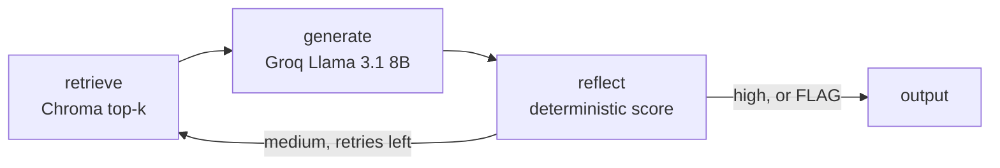

<picture>
  <source media="(prefers-color-scheme: dark)" srcset="assets/header-dark.svg">
  
</picture>

<picture>
  <source media="(prefers-color-scheme: dark)" srcset="assets/typing-dark.svg">
  
</picture>

Data Analyst at NextGenTek USA · Boston  
MS Analytics (Applied Machine Intelligence), Northeastern · B.Tech CS, Lendi / JNTU

<a href="mailto:pranathesw@gmail.com">
  <picture>
    <source media="(prefers-color-scheme: dark)" srcset="assets/email-dark.svg">
    
  </picture>
</a>
&nbsp;
<a href="https://www.linkedin.com/in/devasai-pranatheswar">
  <picture>
    <source media="(prefers-color-scheme: dark)" srcset="assets/linkedin-dark.svg">
    
  </picture>
</a>

<picture>
  <source media="(prefers-color-scheme: dark)" srcset="assets/divider-dark.svg">
  
</picture>

## What I build

- Clinical agents that answer from a protocol, score the draft, and flag a person when the source does not support the claim.
- Genomics and neuro-data tools that keep an evidence trail: ACMG triage, EEG conversion, and neural-privacy audits.
- Analytics pipelines that score a delayed hospital discharge and show a placement step a person can approve.

<picture>
  <source media="(prefers-color-scheme: dark)" srcset="assets/divider-dark.svg">
  
</picture>

## Featured work

<table>
<tr>
<td width="50%" valign="top">

<a href="https://github.com/TechieGoku2623/Sentinal_RAG">
  <picture>
    <source media="(prefers-color-scheme: dark)" srcset="assets/cards/sentinel-rag-dark.svg">
    
  </picture>
</a>

**Problem.** A fluent answer about a dose can still be wrong.

**Approach.** A LangGraph loop retrieves the clinic's own guidelines from Chroma, drafts with Groq, and scores grounding in code.

**Result.** High confidence is returned. Medium confidence widens the retrieval and retries. Low confidence is marked FLAG for a clinician. The bundled corpus is a fictional diabetes guideline.

[▶ Demo](https://github.com/TechieGoku2623/Sentinal_RAG/blob/main/sentinel-rag/docs/demo.gif) · [📐 Architecture](https://github.com/TechieGoku2623/Sentinal_RAG/blob/main/sentinel-rag/docs/ARCHITECTURE.md) · [📄 README](https://github.com/TechieGoku2623/Sentinal_RAG/blob/main/sentinel-rag/README.md)

</td>
<td width="50%" valign="top">

<a href="https://github.com/TechieGoku2623/Clear-Bed">
  <picture>
    <source media="(prefers-color-scheme: dark)" srcset="assets/cards/clearbed-dark.svg">
    
  </picture>
</a>

**Problem.** A patient can be medically ready to leave and still occupy a staffed bed.

**Approach.** DuckDB and dbt build the stay. LightGBM plus SHAP score stuck-risk. A LangGraph agent matches CMS nursing homes and waits for a person to approve anything that would leave the building.

**Result.** The walkthrough is a Boston census against the national CMS Care Compare file. Patients in the demo are synthetic. This is not a medical device.

[▶ Demo](https://github.com/TechieGoku2623/Clear-Bed/blob/main/docs/walkthrough.gif) · [📐 Architecture](https://github.com/TechieGoku2623/Clear-Bed#architecture) · [📄 README](https://github.com/TechieGoku2623/Clear-Bed)

</td>
</tr>
<tr>
<td width="50%" valign="top">

<a href="https://github.com/TechieGoku2623/acmg-triage">
  <picture>
    <source media="(prefers-color-scheme: dark)" srcset="assets/cards/acmg-triage-dark.svg">
    
  </picture>
</a>

**Problem.** A variant of uncertain significance needs a classification a reviewer can retrace, including a refusal.

**Approach.** A typed graph runs one node per ACMG/AMP code, applies a VCEP overlay, and reads literature only from a committed cache.

**Result.** On 100 designed probes, concordance with the rules-only baseline is 0.670. Turning the literature path on does not change that number. Conflicting and uncovered variants are refused.

[▶ Demo](https://github.com/TechieGoku2623/acmg-triage/blob/main/demo/out/acmg-triage-demo.gif) · [📐 Architecture](https://github.com/TechieGoku2623/acmg-triage/blob/main/src/acmg_triage/graph.py) · [📄 README](https://github.com/TechieGoku2623/acmg-triage)

</td>
<td width="50%" valign="top">

<a href="https://github.com/TechieGoku2623/neuroprivacy">
  <picture>
    <source media="(prefers-color-scheme: dark)" srcset="assets/cards/neuroprivacy-dark.svg">
    
  </picture>
</a>

**Problem.** A consumer neural-data policy is hard to compare with a state statute line by line.

**Approach.** The extractor pulls span-cited fields from policy HTML and scores them with deterministic rules for Colorado HB24-1058 and California SB 1223.

**Result.** Mean field F1 is 1.000 against 20 hand-labeled sample policies. The live public-policy hold-out is still open. The output is not a legal opinion.

[▶ Demo](https://github.com/TechieGoku2623/neuroprivacy/blob/main/demo/out/neuroprivacy-demo.gif) · [📐 Architecture](https://github.com/TechieGoku2623/neuroprivacy/blob/main/src/neuroprivacy/scoring.py) · [📄 README](https://github.com/TechieGoku2623/neuroprivacy)

</td>
</tr>
<tr>
<td width="50%" valign="top">

<a href="https://github.com/TechieGoku2623/eeg-harmonize">
  <picture>
    <source media="(prefers-color-scheme: dark)" srcset="assets/cards/eeg-harmonize-dark.svg">
    
  </picture>
</a>

**Problem.** The same EEG channel or annotation goes by different names across public corpora, so a conversion bug looks like a dataset effect.

**Approach.** A canonical record, unit checks, and an append-only provenance chain: read, check units, map channels, resample.

**Result.** Designed EDF clips convert, and a bad unit scale is rejected. The cross-dataset transfer matrix on TUH was not run. TUH is not in the repository.

[▶ Demo](https://github.com/TechieGoku2623/eeg-harmonize/blob/main/demo/out/eeg-harmonize-demo.gif) · [📐 Architecture](https://github.com/TechieGoku2623/eeg-harmonize/blob/main/src/eeg_harmonize/convert.py) · [📄 README](https://github.com/TechieGoku2623/eeg-harmonize)

</td>
<td width="50%" valign="top">

<a href="https://github.com/TechieGoku2623/Hamsa">
  <picture>
    <source media="(prefers-color-scheme: dark)" srcset="assets/cards/hamsa-dark.svg">
    
  </picture>
</a>

**Problem.** A shop order in Hindi or Tamil still has to become a cart, a price the model cannot invent, and a payment the app does not hold.

**Approach.** The browser encrypts chats with P-256 and AES-GCM. A FastAPI agent fills the cart, a verifier rejects invented prices, and UPI is an intent to the merchant.

**Result.** The local demo runs a guest order, an owner confirmation, and an encrypted chat. No user or revenue figures are claimed.

[▶ Demo](https://github.com/TechieGoku2623/Hamsa/blob/main/demo/hamsa-demo.gif) · [📐 Architecture](https://github.com/TechieGoku2623/Hamsa/blob/main/docs/architecture.md) · [📄 README](https://github.com/TechieGoku2623/Hamsa)

</td>
</tr>
</table>

<picture>
  <source media="(prefers-color-scheme: dark)" srcset="assets/divider-dark.svg">
  
</picture>

## Flagship: Sentinel-RAG

How the clinical protocol guardian decides to answer, retry, or flag

Sentinel-RAG answers only from guidelines the operator ingested, then scores the draft before anyone sees it. Research prototype. Not a medical device. Do not use it for a clinical decision.

The compiled graph in `sentinel-rag/src/agent.py` has four nodes: `retrieve`, `generate`, `reflect`, `output`. FLAG is a decision inside `reflect`, written into the response by `output`. It is not a fifth node.

1. **Retrieve.** The query hits a local Chroma index of the ingested protocol documents.
2. **Generate.** The draft is written from those chunks. Live generation needs `GROQ_API_KEY`. The model pin in the repo is Llama 3.1 8B via Groq.
3. **Reflect.** Grounding is scored in code. Medium confidence widens retrieval and loops back to `retrieve`. High confidence, or a low score after retries, goes to `output`. A low score, a contradicted draft, or a query outside the corpus is marked FLAG for a clinician.

[▶ Watch the demo](https://github.com/TechieGoku2623/Sentinal_RAG/blob/main/sentinel-rag/docs/demo.gif) · [Full architecture](https://github.com/TechieGoku2623/Sentinal_RAG/blob/main/sentinel-rag/docs/ARCHITECTURE.md)

<picture>
  <source media="(prefers-color-scheme: dark)" srcset="assets/divider-dark.svg">
  
</picture>

## Tech stack

**Languages**

<picture>
  <source media="(prefers-color-scheme: dark)" srcset="https://skillicons.dev/icons?i=py,ts&theme=dark">
  
</picture>

Python · TypeScript · SQL

**Data**

<picture>
  <source media="(prefers-color-scheme: dark)" srcset="assets/stack-data-dark.svg">
  
</picture>

**ML and GenAI**

<picture>
  <source media="(prefers-color-scheme: dark)" srcset="https://skillicons.dev/icons?i=sklearn&theme=dark">
  
</picture>

<picture>
  <source media="(prefers-color-scheme: dark)" srcset="assets/stack-ml-dark.svg">
  
</picture>

**Cloud**

<picture>
  <source media="(prefers-color-scheme: dark)" srcset="https://skillicons.dev/icons?i=docker&theme=dark">
  
</picture>

**BI**

<picture>
  <source media="(prefers-color-scheme: dark)" srcset="assets/stack-bi-dark.svg">
  
</picture>

Streamlit is the dashboard in Sentinel-RAG and ClearBed.

<picture>
  <source media="(prefers-color-scheme: dark)" srcset="assets/divider-dark.svg">
  
</picture>

## Research and writing

**Crop Yield Forecasting and Fertilizer Recommendation Using Voting Classifier.** IJRTI, June 2023. Co-authored with B. Chakradhar, D. Sai Veena, and A. Vivek while at Lendi Institute of Engineering and Technology. [PDF](https://www.ijrti.org/papers/IJRTI2306158.pdf)

### Latest posts

<!--BLOG-POST-LIST-->
<!-- BLOG-POST-LIST:START -->
No public RSS feed is connected yet.
<!-- BLOG-POST-LIST:END -->

<picture>
  <source media="(prefers-color-scheme: dark)" srcset="assets/divider-dark.svg">
  
</picture>

## Activity

<!--RECENT_ACTIVITY-->
<!--START_SECTION:activity-->
1. 💪 Opened PR [#1](https://github.com/TechieGoku2623/AEON-7080/pull/1) in [TechieGoku2623/AEON-7080](https://github.com/TechieGoku2623/AEON-7080)
<!--END_SECTION:activity-->

<picture>
  <source media="(prefers-color-scheme: dark)" srcset="https://github-readme-stats.vercel.app/api?username=TechieGoku2623&show_icons=true&hide_border=true&title_color=E7EEF4&text_color=C5D0DA&icon_color=3CBBB4&bg_color=07131C">
  
</picture>
&nbsp;
<picture>
  <source media="(prefers-color-scheme: dark)" srcset="https://github-readme-stats.vercel.app/api/top-langs/?username=TechieGoku2623&layout=compact&hide_border=true&langs_count=6&title_color=E7EEF4&text_color=C5D0DA&icon_color=3CBBB4&bg_color=07131C">
  
</picture>

<picture>
  <source media="(prefers-color-scheme: dark)" srcset="https://streak-stats.demolab.com?user=TechieGoku2623&hide_border=true&background=07131C&stroke=07131C&ring=3CBBB4&fire=E3B15A&currStreakNum=E7EEF4&sideNums=E7EEF4&currStreakLabel=93A4B5&sideLabels=93A4B5&dates=6E8294">
  
</picture>

<picture>
  <source media="(prefers-color-scheme: dark)" srcset="dist/github-contribution-grid-snake-dark.svg">
  
</picture>

<picture>
  <source media="(prefers-color-scheme: dark)" srcset="assets/divider-dark.svg">
  
</picture>

## Open to Data and AI roles in Boston and remote

<a href="mailto:pranathesw@gmail.com">
  <picture>
    <source media="(prefers-color-scheme: dark)" srcset="assets/email-dark.svg">
    
  </picture>
</a>
&nbsp;
<a href="https://www.linkedin.com/in/devasai-pranatheswar">
  <picture>
    <source media="(prefers-color-scheme: dark)" srcset="assets/linkedin-dark.svg">
    
  </picture>
</a>
